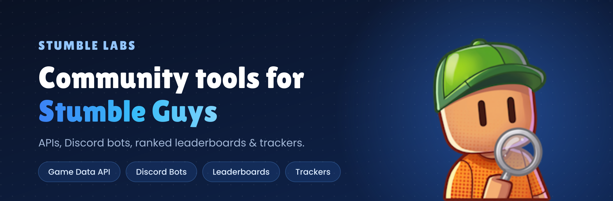

  

  
  
  

## About

StumbleLabs is a community-driven organization from Brazil 🇧🇷 that builds and maintains tools for Stumble Guys players, developers and content creators: game data APIs, Discord bots, ranked leaderboards, asset tooling and more.

> [!NOTE]
> StumbleLabs is an **unofficial fan project**. It is not affiliated with, endorsed by, or sponsored by Scopely or Kitka Games. *Stumble Guys* and all related assets are trademarks of their respective owners.

## Public repositories

| Repository | Description |
|---|---|
| [stumble-labs-api-docs-public](https://github.com/StumbleLabs/stumble-labs-api-docs-public) | Public documentation for the StumbleLabs API, live at [docs.stumblelabs.net](https://docs.stumblelabs.net). |
| [stumble-labs-i18n](https://github.com/StumbleLabs/stumble-labs-i18n) | Translation files for the StumbleLabs website. Contributions in any language are welcome. |
| [WebGL-Unity-WebSERVER](https://github.com/StumbleLabs/WebGL-Unity-WebSERVER) | Web server for running a WebGL build of Stumble Guys in the browser. |

## Other projects

These are developed privately, but they're part of what StumbleLabs runs:

- **stumble-js / stumble-py**: client libraries for Stumble Guys game data (player stats, leaderboards and more), in JavaScript and Python.
- **Discord bots** (JS and Python): game notifications, player rankings, account management and community commands.
- **Leaderboards Ranked Service**: ranked leaderboard tracking, written in TypeScript, with a Mustache-based viewer.
- **Tracker Service**: monitors and logs in-game events and metrics for analytics.
- **Assets Downloader**: automatically fetches bundled game assets on every update.
- **stumble-labs-website**: the source of [stumblelabs.net](https://stumblelabs.net).

## Contributing

Contributions to public repositories are welcome:

1. Fork the repository.
2. Create a branch for your change.
3. Open a pull request explaining what you changed and why.

Found a bug or have an idea? Open an issue in the relevant repository. You can also find us on [Discord](https://discord.gg/BtA9tDJ4Ed).

## License

Each repository has its own license; check its `LICENSE` file. Use of Stumble Guys game data and assets is subject to [Scopely's Terms of Service](https://www.scopely.com/en/legal?id=tos&langSection=en).

---

   
  Maintained by <a href="https://github.com/xDaswx">@xDaswx</a> · Thanks for being part of the StumbleLabs community!

